<div align="center">



<br/>
<br/>

<a href="https://github.com/ishandutta2007/Awesome-Awesome-Awesome"></a> <a href="https://discord.gg/jc4xtF58Ve"></a> <a href="https://github.com/ishandutta2007/Awesome-Python-Linters-Formatters/stargazers"></a> <a href="https://github.com/ishandutta2007/Awesome-Python-Linters-Formatters/network/members"></a> <a href="https://github.com/ishandutta2007/Awesome-Python-Linters-Formatters/blob/main/LICENSE"></a> <a href="https://github.com/ishandutta2007/Awesome-Python-Linters-Formatters/pulls"></a> <a href="https://github.com/ishandutta2007"></a>

<br/>
<br/>

# 🐍 Awesome Python Linters &amp; Formatters

### *A Curated Directory of Rust-Accelerated Linters, Uncompromising Code Formatters &amp; Deep Static Analysis Suites*

</div>

---

## 📖 Executive Summary &amp; Overview

Modern Python development demands rigorous automated code quality gates. This repository provides a comprehensive, production-grade guide to **Python linters**, **code formatters**, **static type checkers**, and **security scanners**. 

Whether you need sub-second CI feedback using next-generation Rust-powered engines like **Ruff**, zero-configuration formatting determinism with **Black**, strict compile-time type verification with **Mypy** or **Pyright**, or enterprise-grade security auditing with **Bandit** and **Semgrep**, this ecosystem directory equips engineering teams to build automated, bulletproof quality pipelines.

### 🎯 Key Highlights:
- ⚡ **Rust-Powered Speed**: Accelerate CI lint steps by up to 100x with unified engines.
- 📐 **PEP 8 Compliance**: Guarantee automated, uniform code formatting and eliminate team style debates.
- 🛡️ **Static Type Safety &amp; AST Security**: Detect logical bugs, type regressions, and vulnerabilities prior to runtime.
- 🔄 **Continuous Quality Orchestration**: Seamless integration across pre-commit hooks, IDEs, and GitHub Actions.

---

## 📑 Table of Contents

- [📊 Sector Overview &amp; Market Dynamics](#-sector-overview--market-dynamics)
- [☁️ SaaS &amp; Hosted Code Quality Platforms](#️-saas--hosted-code-quality-platforms)
- [🛠️ Open-Source GitHub Projects](#️-open-source-github-projects)
  - [⚡ Category Leaders &amp; Formatter Engines](#-category-leaders--formatter-engines)
  - [🛡️ Static Type Checkers &amp; Security Scanners](#️-static-type-checkers--security-scanners)
  - [🔍 Specialized Linters &amp; Refactoring Utilities](#-specialized-linters--refactoring-utilities)
- [⚡ Recommended Modern Stack Setup](#-recommended-modern-stack-setup)
- [🤝 How to Contribute](#-how-to-contribute)
- [⭐ Star History](#-star-history)
- [💖 Support &amp; Sponsoring](#-support--sponsoring)
- [📜 License &amp; Disclaimer](#-license--disclaimer)

---

## 📊 Sector Overview &amp; Market Dynamics

> The global static application security testing (SAST) and developer code quality tooling market was valued at **$5.2 Billion in 2025** and is projected to expand at a **CAGR of 16.8%**, reaching **$11.4 Billion by 2030**.
> 
> The sector exhibits a distinct **bifurcated market structure**: developer-side CLI formatting and linting is **highly concentrated (winner-take-all)** around hyper-fast Rust-native tooling (notably Astral's Ruff and PSF's Black) which have largely displaced legacy multi-tool chains; conversely, the enterprise governance and security scanning layer remains **moderately fragmented** among multi-language DevSecOps suites (Microsoft/GitHub, SonarSource, Snyk, Datadog) and specialized continuous quality platforms competing on compliance, compliance reporting, and deep cross-repository analytics.

---

## ☁️ SaaS &amp; Hosted Code Quality Platforms

Hosted platforms automate linting, pull request quality gating, and security scanning across enterprise repositories. The table below outlines major commercial and hosted solutions, sorted descending by company scale and market valuation:

| 🏢 Platform / Provider | 📈 Company Scale (Valuation / ARR) | 💳 Starting Paid Tier Pricing | 🎁 Free Tier Limits &amp; Trials | 🛠️ Python Capabilities &amp; Key Highlights |
| :--- | :--- | :--- | :--- | :--- |
| **[GitHub Actions &amp; Advanced Security](https://github.com/features/actions)** *(Microsoft)* | **$3.12 Trillion** Market Cap (~$245B ARR) | **$4.00 / user / month** (GitHub Team billed annually) or **$21.00 / user / month** (Enterprise; GHAS add-on at $49/active committer/mo) | **Free forever** for all public open-source repos with unlimited execution minutes &amp; CodeQL scanning; **2,000 Actions minutes/month** and 500 MB package storage for free private accounts. | First-party CI runner for `astral-sh/ruff-action` and `psf/black`. Powers native SARIF security reporting and automated PR checks. |
| **[Datadog Static Analysis](https://www.datadoghq.com/product/static-analysis/)** *(Datadog, Inc.)* | **$40.8 Billion** Market Cap (~$2.6B ARR) | **$15.00 / host / month** (Pro tier base) + **$0.15 / commit** (or $6.00/contributor/mo for Software Delivery Analytics) | **14-day full free trial** across unlimited repositories, scan minutes, and team members; ongoing free tier includes core infrastructure monitoring for up to 5 hosts. | Real-time AST static code analysis directly linked to production APM telemetry and distributed traces, pinpointing performance and security regressions before deploy. |
| **[Snyk Code](https://snyk.io/product/snyk-code/)** *(Snyk Ltd.)* | **$7.4 Billion** Valuation (~$250M+ ARR) | **$25.00 / product / month** (Team plan) or **$52.00 / user / month** (Enterprise tier) | **Free forever plan** with **100 code analysis tests/month** for private repos; unlimited automated security scans for public open-source repositories. | Real-time AI-assisted SAST engine that scans Python code for OWASP Top 10 vulnerabilities, insecure cryptographic imports, and SQL injection flaws in seconds. |
| **[SonarQube Cloud](https://www.sonarsource.com/products/sonarcloud/)** *(SonarSource)* | **$4.7 Billion** Valuation (~$200M ARR) | **€10.00 / month** (~$11.00/mo) for up to 100,000 lines of code (LOC), scaling with repository size | **Free forever** for all public open-source repositories with unlimited lines of code and unlimited collaborators; **14-day free trial** on private repos up to 250k LOC. | Deep semantic code inspection and "Clean as You Code" quality gates, checking Python code smells, cyclomatic complexity, test coverage thresholds, and security hotspots. |
| **[Codacy Quality](https://www.codacy.com/)** *(Codacy)* | **$150 Million** Valuation (~$22M ARR) | **$15.00 / user / month** (billed annually at $180/yr) or **$18.00 / user / month** (billed monthly) | **Free forever** for public open-source projects with unlimited users; **14-day free trial** on private repositories with complete multi-engine analysis access. | Automated code review orchestrator executing Flake8, Pylint, Bandit, and coverage metrics on every PR, providing unified PR status checks and technical debt dashboards. |
| **[DeepSource Python](https://deepsource.com/)** *(DeepSource)* | **$50 Million** Valuation (~$10M ARR) | **$12.00 / team member / month** (billed annually) or **$15.00 / team member / month** (billed monthly) | **Free forever** for individual developers on unlimited public repos and up to **3 private repos** with 1 team member. | Continuous static analyzer with Autofix capabilities; automatically detects anti-patterns, performance pitfalls, and type bugs, generating 1-click pull request remedies. |
| **[pre-commit.ci](https://pre-commit.ci/)** *(pre-commit.ci LLC)* | **Bootstrapped** (~$500K ARR) | **$5.00 / month** per private repository (or $1.00 / user / month for organizations) | **Free forever** for 100% of public open-source repositories with automated auto-fix commits on pull requests. | Managed cloud execution service for git pre-commit hooks; automatically runs Ruff, Black, isort, and pyupgrade on PRs and pushes fix commits back to the branch. |

---

## 🛠️ Open-Source GitHub Projects

Below are the premier open-source tools for linting, formatting, type checking, and securing Python codebases. **Sorted strictly in descending order by GitHub stargazers count**:

### ⚡ Category Leaders &amp; Formatter Engines

1. **[Ruff](https://github.com/astral-sh/ruff)** <a href="https://github.com/astral-sh/ruff/stargazers"></a>  
   *An extremely fast Python linter and code formatter, written in Rust.*  
   - **Highlights**: 10–100x faster than legacy Python linters; replaces Flake8, isort, pydocstyle, pyupgrade, autoflake, and Black in a single static binary.
   - **Rules**: Features over 900 built-in rules with native `--fix` autofix capabilities and Black-compatible code formatting (`ruff format`).
   - **License**: MIT | **Maintainer**: Astral

2. **[Black](https://github.com/psf/black)** <a href="https://github.com/psf/black/stargazers"></a>  
   *The uncompromising Python code formatter.*  
   - **Highlights**: The definitive standard for opinionated Python formatting. Formats entire files to a deterministic style (88-char default, standardized quotes and commas).
   - **Integration**: PSF-governed, supported natively in pre-commit, CI/CD, and all major code editors.
   - **License**: MIT | **Maintainer**: Python Software Foundation

3. **[Mypy](https://github.com/python/mypy)** <a href="https://github.com/python/mypy/stargazers"></a>  
   *Optional static typing for Python.*  
   - **Highlights**: The official reference type checker for Python (PEP 484). Detects invalid variable assignments, incorrect function signatures, and `None`-dereference bugs before runtime.
   - **Performance**: Includes daemon mode (`dmypy`) for ultra-responsive incremental checking in large codebases.
   - **License**: MIT | **Maintainer**: Python Core Developers &amp; Community

4. **[Semgrep](https://github.com/semgrep/semgrep)** <a href="https://github.com/semgrep/semgrep/stargazers"></a>  
   *Lightweight, multi-language static analysis for finding bugs and enforcing security patterns.*  
   - **Highlights**: Allows writing custom AST pattern checks using ordinary Python syntax patterns rather than complex regex or AST visitor code.
   - **Ecosystem**: Massive public registry of community security rules for FastAPI, Django, Flask, and cryptography.
   - **License**: LGPL-2.1 | **Maintainer**: Semgrep, Inc.

5. **[Pyright](https://github.com/microsoft/pyright)** <a href="https://github.com/microsoft/pyright/stargazers"></a>  
   *Fast, full-featured static type checker for Python, written in TypeScript.*  
   - **Highlights**: Powers Microsoft's Pylance VS Code extension; delivers instantaneous type evaluation and hover insights on large mono-repositories.
   - **Capabilities**: Supports PEP 544 structural subtyping, PEP 695 type parameter syntax, and strict type verification.
   - **License**: MIT | **Maintainer**: Microsoft

6. **[YAPF](https://github.com/google/yapf)** <a href="https://github.com/google/yapf/stargazers"></a>  
   *Yet Another Python Formatter from Google.*  
   - **Highlights**: Takes code and reformats it to the best formatting that conforms to style guides, inspired by clang-format. Avoids arbitrary line breaks by scoring layout penalties.
   - **Configuration**: Highly configurable via `.style.yapf` or `pyproject.toml`.
   - **License**: Apache-2.0 | **Maintainer**: Google

7. **[SQLFluff](https://github.com/sqlfluff/sqlfluff)** <a href="https://github.com/sqlfluff/sqlfluff/stargazers"></a>  
   *A modular SQL linter and auto-formatter with first-class Python templating support.*  
   - **Highlights**: Essential companion for Python data engineering pipelines; parses and formats raw and Jinja/dbt-templated SQL queries embedded inside Python applications.
   - **License**: MIT | **Maintainer**: SQLFluff Community

8. **[Bandit](https://github.com/PyCQA/bandit)** <a href="https://github.com/PyCQA/bandit/stargazers"></a>  
   *A tool designed to find common security issues in Python code.*  
   - **Highlights**: PyCQA standard security scanner. Builds an AST and executes plugins to flag hardcoded secrets, shell injections, unsafe YAML/pickle parsing, and vulnerable cryptographic functions.
   - **Licensing**: Apache-2.0 | **Maintainer**: PyCQA

9. **[Pyre-Check](https://github.com/facebook/pyre-check)** <a href="https://github.com/facebook/pyre-check/stargazers"></a>  
   *Performant static type-checking and security taint analysis for Python.*  
   - **Highlights**: Developed by Meta in OCaml for massive scale; includes Pysa (Python Static Analyzer) for tracking sensitive data flow and security taint across large microservices.
   - **License**: MIT | **Maintainer**: Meta Open Source

10. **[isort](https://github.com/PyCQA/isort)** <a href="https://github.com/PyCQA/isort/stargazers"></a>  
    *A Python utility and library to sort imports automatically.*  
    - **Highlights**: Sorts imports alphabetically and automatically categorizes them into Future, Standard Library, Third Party, and Local blocks with full Black profile compatibility.
    - **License**: MIT | **Maintainer**: PyCQA

---

### 🛡️ Static Type Checkers &amp; Security Scanners

11. **[Pylint](https://github.com/pylint-dev/pylint)** <a href="https://github.com/pylint-dev/pylint/stargazers"></a>  
    *Deep static analysis and anti-pattern linter.*  
    - **Highlights**: Goes far beyond syntax rules to perform deep semantic inference, detecting dead code, unused parameters, design smells, and interface violations.
    - **License**: GPL-2.0 | **Maintainer**: PyCQA / pylint-dev

12. **[pycodestyle](https://github.com/PyCQA/pycodestyle)** <a href="https://github.com/PyCQA/pycodestyle/stargazers"></a>  
    *Simple, official Python style guide checker (formerly `pep8`).*  
    - **Highlights**: Validates source code against PEP 8 style conventions (indentation, whitespace, naming patterns). Core engine behind Flake8.
    - **License**: MIT | **Maintainer**: PyCQA

13. **[Pytype](https://github.com/google/pytype)** <a href="https://github.com/google/pytype/stargazers"></a>  
    *Google's static type analyzer for Python.*  
    - **Highlights**: Infers types on unannotated Python code without requiring upfront type annotations, and can automatically generate type stub files (`.pyi`).
    - **License**: Apache-2.0 | **Maintainer**: Google

14. **[autopep8](https://github.com/hhatto/autopep8)** <a href="https://github.com/hhatto/autopep8/stargazers"></a>  
    *A tool that automatically formats Python code to conform to PEP 8.*  
    - **Highlights**: Minimal-intervention auto-formatter that targets specific PEP 8 errors flagged by `pycodestyle` without completely reflowing untouched code blocks.
    - **License**: MIT | **Maintainer**: Hideo Hattori

15. **[pyupgrade](https://github.com/asottile/pyupgrade)** <a href="https://github.com/asottile/pyupgrade/stargazers"></a>  
    *A tool and pre-commit hook to automatically upgrade syntax for newer Python releases.*  
    - **Highlights**: Automatically modernizes Python code (converting `format()` to f-strings, upgrading dictionary comprehensions, removing redundant `object` inheritance).
    - **License**: MIT | **Maintainer**: Anthony Sottile

16. **[Flake8](https://github.com/PyCQA/flake8)** <a href="https://github.com/PyCQA/flake8/stargazers"></a>  
    *Classic Python linting wrapper gluing together Pyflakes, pycodestyle, and McCabe complexity.*  
    - **Highlights**: Extensive third-party plugin ecosystem (e.g., `flake8-bugbear`, `flake8-docstrings`, `flake8-comprehensions`).
    - **License**: MIT | **Maintainer**: PyCQA

---

### 🔍 Specialized Linters &amp; Refactoring Utilities

17. **[Prospector](https://github.com/prospector-dev/prospector)** <a href="https://github.com/prospector-dev/prospector/stargazers"></a>  
    *Aggregated Python analysis engine.*  
    - **Highlights**: Automatically configures and aggregates outputs from Pylint, Pyflakes, pycodestyle, McCabe, and Dodgy into a single coherent report.
    - **License**: GPL-2.0 | **Maintainer**: Prospector Team

18. **[Radon](https://github.com/rubik/radon)** <a href="https://github.com/rubik/radon/stargazers"></a>  
    *Code metrics and complexity analysis for Python.*  
    - **Highlights**: Computes Cyclomatic Complexity, Maintainability Index (MI), Raw Metrics (LOC, SLOC, comments), and Halstead metrics.
    - **License**: MIT | **Maintainer**: Michele Lacchia

19. **[Sourcery CLI](https://github.com/sourcery-ai/sourcery)** <a href="https://github.com/sourcery-ai/sourcery/stargazers"></a>  
    *Automated AI-assisted refactoring and code quality recommendations.*  
    - **Highlights**: Analyzes ASTs to propose modern refactorings, reducing nested loops, simplifying conditionals, and improving readability.
    - **License**: Proprietary / Community CLI | **Maintainer**: Sourcery AI

20. **[Pyflakes](https://github.com/PyCQA/pyflakes)** <a href="https://github.com/PyCQA/pyflakes/stargazers"></a>  
    *Passive logical error detector.*  
    - **Highlights**: Parses source files without executing code, catching undefined variables, shadowed imports, and unused definitions with virtually zero false positives.
    - **License**: MIT | **Maintainer**: PyCQA

21. **[autoflake](https://github.com/PyCQA/autoflake)** <a href="https://github.com/PyCQA/autoflake/stargazers"></a>  
    *Removes unused imports and unused variables.*  
    - **Highlights**: Uses Pyflakes under the hood to automatically delete unused imports and dead variables directly in files or verify in CI (`--check`).
    - **License**: MIT | **Maintainer**: PyCQA

22. **[complexipy](https://github.com/rohaquinlop/complexipy)** <a href="https://github.com/rohaquinlop/complexipy/stargazers"></a>  
    *Blazingly fast cognitive complexity analyzer for Python, written in Rust.*  
    - **Highlights**: Measures cognitive complexity (how hard code is to understand) rather than simple cyclomatic branching, identifying cognitive overload hotspots.
    - **License**: MIT | **Maintainer**: Roberto Alonso

23. **[Fixit](https://github.com/Instagram/Fixit)** <a href="https://github.com/Instagram/Fixit/stargazers"></a>  
    *Custom in-repo linting and auto-fix framework by Meta/Instagram.*  
    - **Highlights**: Uses LibCST to make creating custom repository-specific linting rules and auto-fixes straightforward for large engineering teams.
    - **License**: MIT | **Maintainer**: Meta / Instagram Engineering

24. **[McCabe](https://github.com/PyCQA/mccabe)** <a href="https://github.com/PyCQA/mccabe/stargazers"></a>  
    *Ned's cyclomatic complexity script for Python.*  
    - **Highlights**: Inspects AST graphs to calculate Thomas J. McCabe cyclomatic complexity numbers; flags functions requiring refactoring or test decomposition.
    - **License**: MIT | **Maintainer**: PyCQA

25. **[docformatter](https://github.com/PyCQA/docformatter)** <a href="https://github.com/PyCQA/docformatter/stargazers"></a>  
    *Formats docstrings to conform to PEP 257 standards.*  
    - **Highlights**: Auto-formats single-line and multi-line docstring summaries, descriptions, and wrap margins to standard conventions.
    - **License**: MIT | **Maintainer**: PyCQA

26. **[Blue](https://github.com/grantjenks/blue)** <a href="https://github.com/grantjenks/blue/stargazers"></a>  
    *The slightly less uncompromising Python code formatter.*  
    - **Highlights**: Fork of Black that favors single quotes for strings and retains standard line lengths, offering a softer aesthetic for teams preferring single-quote syntax.
    - **License**: MIT | **Maintainer**: Grant Jenks

---

## ⚡ Recommended Modern Stack Setup

For new Python projects in 2026, the industry standard recommended stack combines:
1. **Ruff** for sub-second linting, import sorting, and Black-compatible formatting.
2. **Mypy** or **Pyright** for strict static type checking.
3. **pre-commit** for catching regressions locally prior to git push.

### Minimal `pyproject.toml` Configuration:

```toml
[tool.ruff]
line-length = 88
target-version = "py312"

[tool.ruff.lint]
select = [
    "E",   # pycodestyle errors
    "W",   # pycodestyle warnings
    "F",   # Pyflakes logical errors
    "I",   # isort import order
    "B",   # flake8-bugbear bug detection
    "UP",  # pyupgrade syntax modernization
    "S",   # flake8-bandit security issues
]
ignore = ["E501"]  # Line length handled automatically by ruff format

[tool.ruff.format]
quote-style = "double"
indent-style = "space"

[tool.mypy]
python_version = "3.12"
warn_return_any = true
warn_unused_configs = true
disallow_untyped_defs = true
```

---

## 🤝 How to Contribute

We welcome additions, updates, and benchmark contributions from the community!

1. **Fork** the repository on GitHub.
2. **Add or update** entries in `README.md` maintaining alphabetical or star-based sorting and accurate factual descriptions.
3. **Ensure valid URLs** and adhere to existing Markdown table and badge styling.
4. **Submit a Pull Request** with a concise description of your changes.

Check out [Awesome-Awesome-Awesome](https://github.com/ishandutta2007/Awesome-Awesome-Awesome) for more curated lists!

---

## ⭐ Star History

[](https://star-history.dera.page/#ishandutta2007/Awesome-Python-Linters-Formatters&type=date&legend=top-left)

---

## 💖 Support &amp; Sponsoring

If you find this curated directory of Python Linters &amp; Formatters helpful for your developer workflow and engineering team:

- ⭐ **Star this repository** to help other Python developers discover it!
- 🍴 **Fork and share** it across your developer communities and teams.
- ☕ **Sponsor continued curation** by supporting on the [GitHub Sponsors Dashboard](https://github.com/sponsors/ishandutta2007).

Your support enables continuous updates, verified links, and ecosystem monitoring!

---

## 📜 License &amp; Disclaimer

- Distributed under the **MIT License**. See [`LICENSE`](LICENSE) for complete terms.
- *Disclaimer*: This repository is an independent community-curated educational resource. Product names, logos, and trademarks mentioned are the property of their respective owners.
